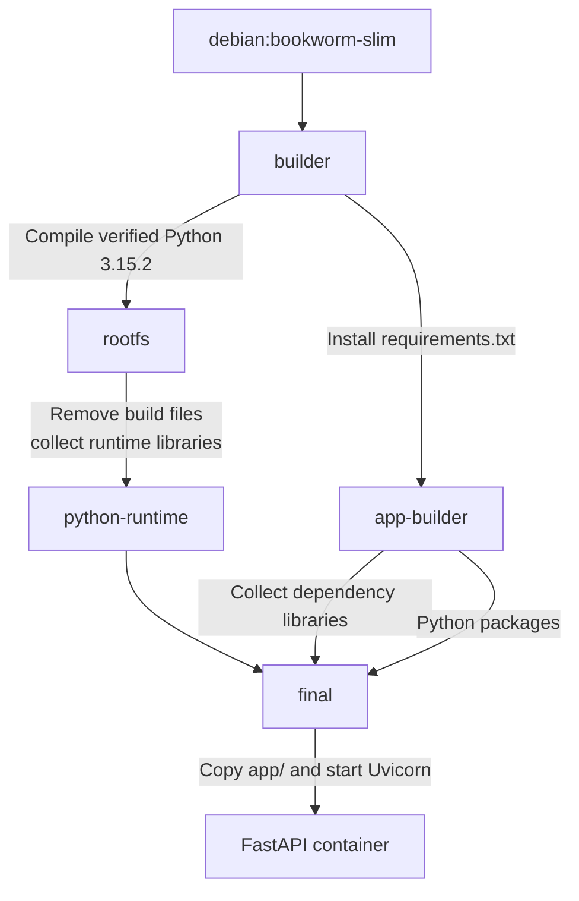
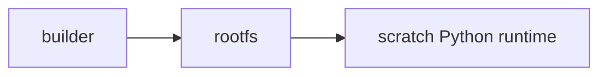
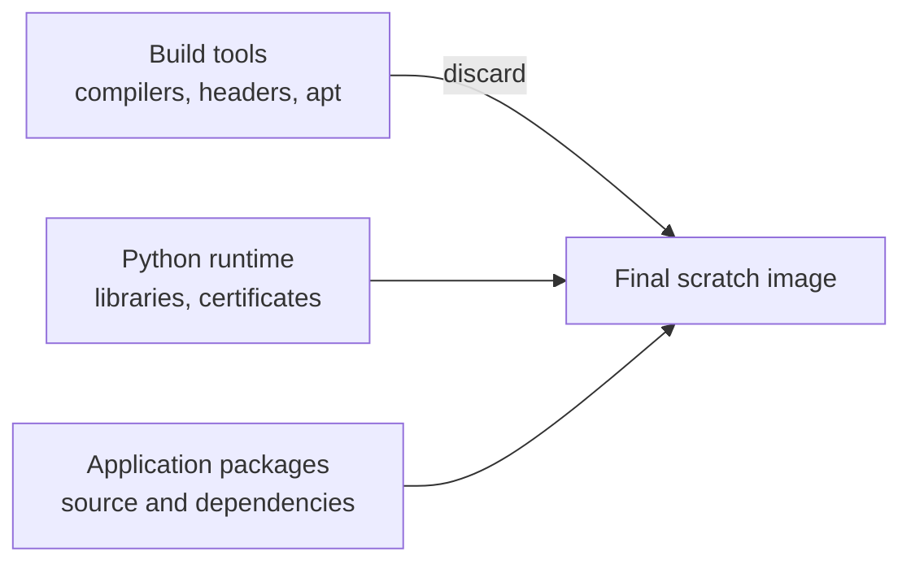

# Dockerfile flow

This repository has two Dockerfiles:

- [`Dockerfile`](./Dockerfile): minimal Python runtime.
- [`Dockerfile-slim`](./Dockerfile-slim): minimal Python runtime plus the
  FastAPI application.

## Application image: `Dockerfile-slim`



### Stages

| Stage | Purpose |
|---|---|
| `builder` | Compiles Python from a checksum-verified source archive. |
| `rootfs` | Builds a small filesystem with Python, libraries, certificates, and a non-root user. |
| `python-runtime` | Creates the minimal `scratch` Python runtime. |
| `app-builder` | Installs `requirements.txt` outside the final image. |
| `final` | Copies the runtime, dependencies, and application into the deployable image. |

### 1. `builder`

```dockerfile
FROM debian:bookworm-slim AS builder
```

- Installs compilers and Python build dependencies.
- Downloads Python 3.15.2.
- Verifies the SHA-256 checksum.
- Installs Python under `/opt/python`.
- Upgrades pip to the pinned version.

Build tools stay in this intermediate stage.

### 2. `rootfs`

```dockerfile
FROM builder AS rootfs
```

- Copies Python into `/rootfs`.
- Removes tests, headers, caches, static archives, and debug symbols.
- Finds and copies shared-library dependencies with `lddtree`.
- Adds CA certificates and DNS/NSS libraries.
- Creates UID/GID `10001` and the runtime directories.

The directory becomes the filesystem for the scratch image.

### 3. `python-runtime`

```dockerfile
FROM scratch AS python-runtime
```

- Copies `/rootfs` into a shell-free `scratch` image.
- Sets Python paths and certificate settings.
- Uses `/app` as the working directory.
- Runs as non-root user `10001:10001`.

This stage is a reusable Python runtime base.

### 4. `app-builder`

```dockerfile
FROM builder AS app-builder
```

- Copies [`requirements.txt`](./requirements.txt).
- Installs FastAPI, Uvicorn, and HTTPX into `/app/dependencies`.
- Finds native libraries required by installed packages.

The compiler and package-installation tools are excluded from the final image.

### 5. `final`

```dockerfile
FROM python-runtime AS final
```

- Copies dependency libraries and Python packages.
- Copies [`app/`](./app/).
- Sets `PYTHONPATH=/app/dependencies`.
- Exposes port `8000`.
- Starts:

```text
python3 -m uvicorn app.main:app --host 0.0.0.0 --port 8000
```

The API is implemented in [`app/main.py`](./app/main.py) and provides:

```text
GET /
GET /healthcheck
```

## Runtime image: `Dockerfile`



This file contains the first three logical stages only:

1. `builder` compiles Python.
2. `rootfs` prepares and minimizes the runtime filesystem.
3. The final `scratch` stage runs `python3`.

It does not install application dependencies or copy the FastAPI source.

## Why use multi-stage builds?



- Smaller production image.
- No compiler or package manager at runtime.
- Python source integrity is checked before compilation.
- The application runs without root privileges.
- Explicit libraries preserve Python, HTTPS, DNS, and native-package support.

The `scratch` trade-off is that the running image has no shell or diagnostic
utilities. Use an intermediate stage for debugging.

## Build command

```sh
docker buildx build --load \
  -f Dockerfile-slim \
  -t python-scratch:3.15.2-slim .
```
